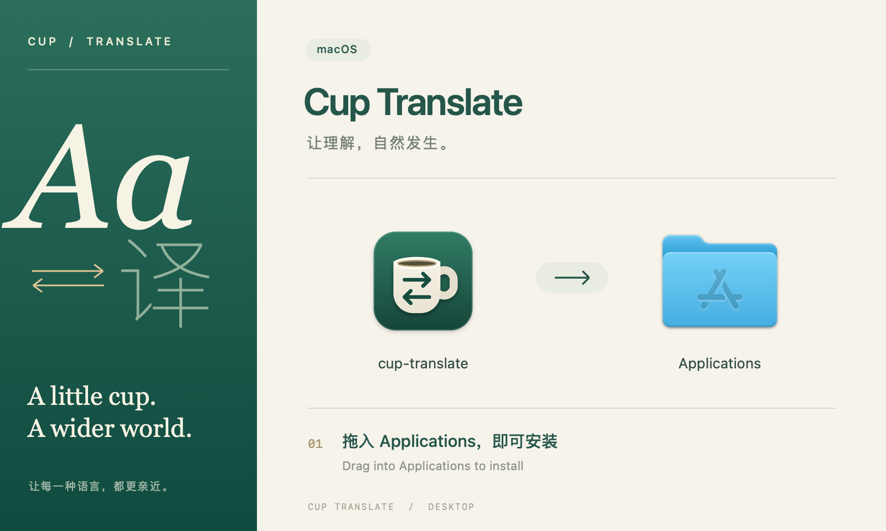
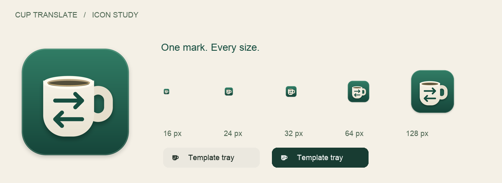

# Cup macOS 品牌与安装页

本轮已接入实际资源和打包配置。设计源与重建命令见 [图标资源说明](../../../packaging/ICONS.md)。

- **图标**：墨绿圆角底板、瓷白杯体、暖色杯口与双向翻译箭头；保留 Cup 识别，增加材质层次。
- **安装页**：800×480 点，左侧双语排印，右侧原生拖拽安装；提供中文提示与英文副提示。
- **高清资源**：背景 2× / 144 DPI；图标含 ICNS、ICO 与各平台 PNG。

预览图用于说明设计布局；Finder 会使用系统自己的标签字体、文件夹样式和别名标记。实际检查使用现有本地 app 的副本替换图标后打包，只验证视觉与镜像结构，不作为新版本程序发布。

验证：已生成 DMG 并通过 `hdiutil verify`，在 Finder 中检查原生图标、别名箭头与背景对齐。根据实测，窗口高度包含 32 点标题栏，因此最终配置使用 800×512 点，给背景保留完整的 800×480 点内容区。`tests/desktop-release.test.mjs` 的 4 项测试通过，`git diff --check` 通过。

本轮未完成完整应用重编译：本机 `pnpm build` 被现有 pnpm/锁文件设置兼容问题拦截；直接 Vite 构建长时间停留在 transforming 后已中止。没有修改依赖或发布新版本。

